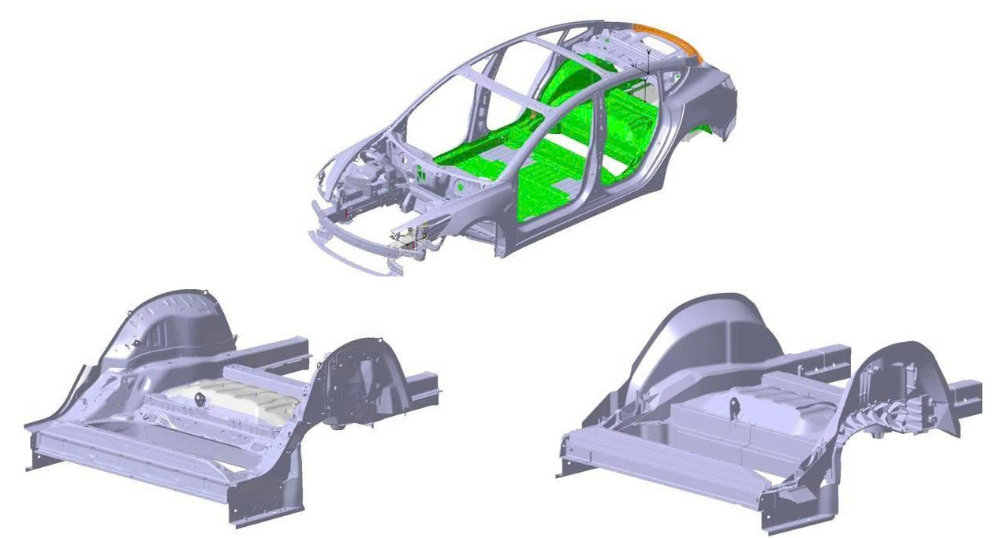

# CAD and Structural Concepts | Vectenor Engineering

## Tesla Model 3 rear-underfloor casting research

Research into updating the Tesla Model 3 rear-underfloor assembly to a casting-based concept. The work explores structural integration, component consolidation, and the interface between the proposed rear-underfloor structure and the surrounding body-in-white.

The project demonstrates concept development and structural-model preparation for subsequent assessment. Quantitative mass, stiffness, durability, crashworthiness, and manufacturing conclusions depend on the corresponding verified analysis and process studies.

## Related model examples

[Door-slam and body-in-white bending input models](https://github.com/vectenor-engineering/abaqus-structural-analysis)

[Vectenor Engineering](https://github.com/vectenor-engineering)
